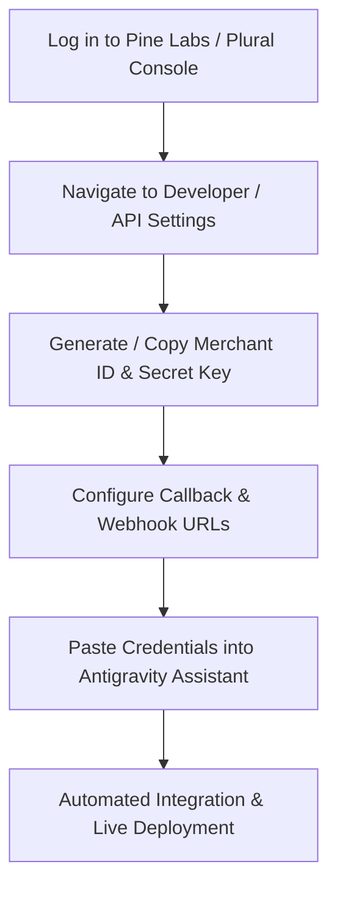

# Pine Labs (Plural) Payment Gateway Migration Guide

**Document Version:** 1.0  
**Project:** Dappersfit Luxury Timepieces  
**Target Gateway:** Pine Labs Online Payment Gateway / Plural by Pine Labs  
**Date:** November 2026  

---

## 1. Executive Summary

This document outlines the complete plan, requirements, and technical architecture to transition Dappersfit’s online payment gateway from **Cashfree** to **Pine Labs (Plural by Pine Labs)**. 

Pine Labs is one of India's premier payment aggregators, offering significant advantages for luxury e-commerce, including robust multi-bank EMI support, high transaction success rates on high-value orders, and universal UPI/card acceptance.

---

## 2. Information Required From Store Owner

To integrate Pine Labs into the Dappersfit codebase and connect it to your live Supabase database, you will need to provide the following credentials:

| Parameter | Description | Example / Format |
| :--- | :--- | :--- |
| **Merchant ID (Client ID)** | Unique merchant identifier assigned by Pine Labs | `PL_M_XXXXXXXX` or numeric ID |
| **Merchant Secret / API Key** | Secret cryptographic key used to generate HMAC-SHA256 signatures | `pl_sec_xxxxxxxxxxxxxxxxxxxx` |
| **Merchant Access Code** | Access code provided in the Plural / Pine Labs portal (if applicable) | `PL_ACCESS_XXXX` |
| **Environment Mode** | Desired deployment mode | `sandbox` (for testing) or `production` (for live payments) |
| **Webhook Secret** *(Optional)* | Secret key to verify asynchronous webhook status updates | `whsec_xxxxxxxxxxxxxxxx` |

---

## 3. How to Obtain Credentials from Pine Labs Portal

Follow these steps to obtain your API credentials:



### Step-by-Step Instructions:
1. **Log in to the Portal**:
   - For **Plural by Pine Labs**: Visit [console.pluralonline.com](https://console.pluralonline.com)
   - For **Pine Labs Merchant Portal**: Visit [merchant.pinelabs.com](https://merchant.pinelabs.com)
2. **Access API Keys**:
   - In the left sidebar, click **Settings** &rarr; **API Keys** (or **Developer Settings**).
   - In the API keys section, click **Generate New Key** (or copy existing keys).
   - Copy both the **Client ID / Merchant ID** and the **Client Secret / API Key**.
3. **Configure Webhook / Return URL**:
   - **Return URL**: `https://dappersfit.com/cart?status=success`
   - **Webhook URL**: `https://dappersfit.com/api/pinelabs/verify`
4. **Choose Test vs. Live**:
   - While your KYC documents are under review, you can test using the **Sandbox / UAT** toggle on the dashboard.
   - Once your bank account is verified, switch to **Production** mode.

---

## 4. Technical Architecture & Codebase Changes

All necessary codebase modifications will be automated without interrupting your store's operation:

### A. Backend Integration Engine (`src/lib/pinelabs.ts`)
- Implements Pine Labs order creation API (`/api/v1/order/create` or Plural checkout session).
- Computes cryptographic **HMAC-SHA256 hash** using the secret key to ensure order amounts and payloads cannot be modified in transit.
- Server-to-server payment verification verifying status directly with Pine Labs servers before marking the order as "Paid".

### B. Dedicated Server API Routes
1. **`/api/pinelabs/create-order`**:
   - Validates cart total (including watch prices and the ₹499 Rolex box add-on).
   - Creates an order session on Pine Labs.
   - Returns a secure payment token or checkout URL to the frontend.
2. **`/api/pinelabs/verify`**:
   - Validates the payment signature sent back by Pine Labs.
   - Updates the order in **Supabase PostgreSQL** from `"pending"` to `"Paid"` / `"Confirmed"`.
   - Records the unique Pine Labs Payment Reference ID.

### C. Frontend Checkout UI (`src/app/cart/page.tsx`)
- Updates the payment selector from Cashfree to **Pine Labs Secure Checkout**.
- Loads the official Pine Labs / Plural Checkout JS modal or hosted redirect.
- Provides customer trust badges: *"Pine Labs 256-bit Bank Grade Security"*, *"All Major Cards, UPI & No-Cost EMI Accepted"*.

### D. Supabase Database Updates
- The `Order` table schema already supports multiple payment gateways seamlessly:
  - `paymentMethod: "pinelabs"`
  - `paymentStatus: "paid"`
  - `notes: "Pine Labs Payment Verified | Ref: <TRANSACTION_ID>"`

### E. Admin Dashboard & Notifications
- [`src/components/admin/OrdersManager.tsx`](file:///C:/Users/hi/.gemini/antigravity/scratch/dappersfit/src/components/admin/OrdersManager.tsx) will display `Pine Labs Online` alongside COD orders.
- WhatsApp order receipts sent to both you and the customer will automatically include the Pine Labs transaction reference number.

---

## 5. Pine Labs vs. Cashfree Comparison for Luxury Watches

| Feature | Cashfree | Pine Labs (Plural) | Impact on Dappersfit |
| :--- | :--- | :--- | :--- |
| **Brand & Bank EMI** | Standard | **Industry Leader** | Significant boost for ₹2,499 – ₹3,999+ luxury watch conversions |
| **UPI Acceptance** | GPay, PhonePe, Paytm | GPay, PhonePe, Paytm, Cred | Universal UPI coverage across all apps |
| **International Cards** | Supported | Supported | Allows NRI / international client purchases |
| **Settlement Timeline** | T+1 or T+2 days | T+1 or T+2 days | Predictable cash flow directly to your business account |
| **Brand Reputation** | Recognized fintech | Historic banking & POS leader | High consumer trust at checkout |

---

## 6. Environment Variables Setup

Once you supply the credentials, your environment configuration will be updated as follows:

```env
# Pine Labs / Plural Gateway Configuration
PINELABS_MERCHANT_ID="your_merchant_id_here"
PINELABS_SECRET_KEY="your_secret_key_here"
PINELABS_ACCESS_CODE="your_access_code_here" # if required by Plural
PINELABS_ENV="production" # Use "sandbox" for test mode
```

---

## 7. Migration Checklist

- [ ] **Step 1:** Store owner obtains Merchant ID & Secret Key from Pine Labs portal.
- [ ] **Step 2:** Antigravity builds `src/lib/pinelabs.ts` and API endpoints.
- [ ] **Step 3:** Checkout page updated with Pine Labs payment flow.
- [ ] **Step 4:** Test sandbox transaction (UPI and Card simulation) with Supabase order creation.
- [ ] **Step 5:** Push code changes to GitHub repository (`bunny-9015/dappersfit-official`).
- [ ] **Step 6:** Add Pine Labs environment variables in Vercel project settings and deploy.
- [ ] **Step 7:** Run live ₹1 or test transaction on production to verify bank settlement.
